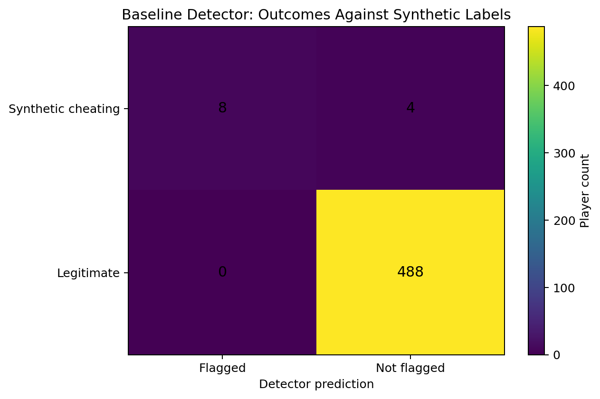

## Game Integrity Investigation Lab
Behavioral Telemetry Analysis | Security Investigations | Detection Evaluation
## Overview

The Game Integrity Investigation Lab is a security analytics project designed to investigate suspicious gameplay behavior using synthetic multiplayer game telemetry.

The project simulates an investigation workflow in which an analyst reviews gameplay statistics, reaction-time measurements, movement patterns, and detection alerts to identify potentially anomalous player behavior.

Rather than treating individual metrics as definitive evidence, the investigation combines multiple signals, evaluates detection performance, and documents the limitations of automated flagging.

This project uses synthetic data and is not affiliated with or based on proprietary data from Sony Interactive Entertainment or PlayStation.

## Research Questions
Which gameplay behaviors are most useful for identifying potentially suspicious players?
How can SQL investigations combine player statistics, gameplay events, and detection alerts into an evidence-based assessment?
What are the trade-offs between conservative detection rules and more sensitive event-level detection?
How do false negatives reveal weaknesses in a detection strategy?
How should an analyst distinguish a suspicious signal from sufficient evidence to support escalation?
Investigation Workflow

The project follows six investigative stages:

Telemetry profiling — Establish player-level behavioral baselines.
Performance analysis — Compare gameplay statistics and identify unusual patterns.
Reaction-time analysis — Examine unusually short reaction times.
Alert correlation — Identify players associated with repeated detection alerts.
Evidence development — Assemble relevant statistics, alerts, and event-level observations for a candidate investigation.
Detection evaluation — Compare detector predictions with synthetic evaluation labels and investigate missed cases.
Technology Stack
SQL — Behavioral analysis, aggregation, filtering, and evidence development.
Python — Synthetic telemetry generation and detector evaluation.
Pandas — Data processing and evaluation.
Matplotlib — Analytical visualizations.
SQLite — Local database analysis.

Adjust this list to reflect the libraries and tools actually used in the repository.

## Key Findings
Baseline Detector

The baseline detector produced the following results on the synthetic dataset:

Metric	Result
True positives	8
False positives	0
False negatives	4
True negatives	488
Precision	100%
Recall	66.7%
False-positive rate	0%

These metrics describe performance against the project's injected synthetic labels. They do not establish real-world game security effectiveness.

The detector identified eight of the twelve players labeled as suspicious, while missing four. Investigating those false negatives revealed that the baseline's strict aggregate-statistic thresholds excluded some cases despite other suspicious signals.

## Event-Level Detection Experiment

An exploratory event-level detector identified ten of the twelve synthetic cheating-labeled players, compared with eight for the baseline detector.

This is a preliminary recall comparison, not a completed detector comparison. The event-level detector's false positives across legitimate players must be calculated before its overall performance can be assessed.

## Analytical Visualizations

The repository includes visualizations of:

Baseline detector performance.
The preliminary recall comparison.
How individual synthetic cases changed classification between detectors.

These charts support the investigation and highlight where additional validation is required.

## Reproducibility

The project includes scripts to generate synthetic gameplay telemetry and evaluate the baseline detector.

After installing the required dependencies, users can regenerate the data and run the evaluation using the instructions below.

python src/generate_data.py
python src/evaluate_detector.py

Update these commands if the scripts retain different paths or require additional arguments.

SQL investigations can be found in the sql/ directory.

## Limitations
The dataset is synthetic and does not represent actual player behavior.
Synthetic labels are assigned during data generation and are not independently verified findings.
Detection thresholds are exploratory and have not been validated against real-world telemetry.
Gameplay signals can be correlated, and individual anomalies do not independently establish misconduct.
The event-level detector requires a complete evaluation of false positives and overall performance.
Risk scores in this project should not be interpreted as calibrated probabilities.
## Conclusion

This project demonstrates a structured approach to security analytics: investigate behavioral signals, correlate evidence, evaluate detection logic, analyze missed cases, and document uncertainty.

The objective is not to automatically declare a player guilty, but to identify cases that warrant further human review and improve detection logic through systematic evaluation.

## Project Report

[Read the Investigation Report](reports/game_integrity_investigation_portfolio_report.pdf)

## Visualizations

